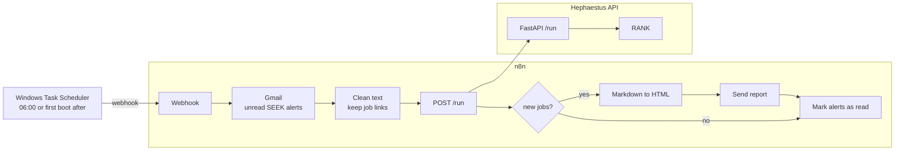
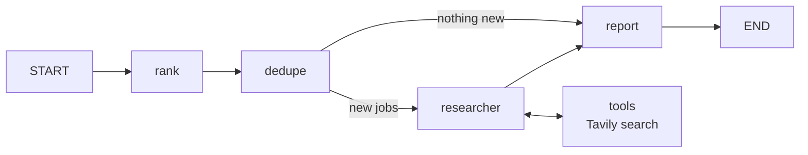
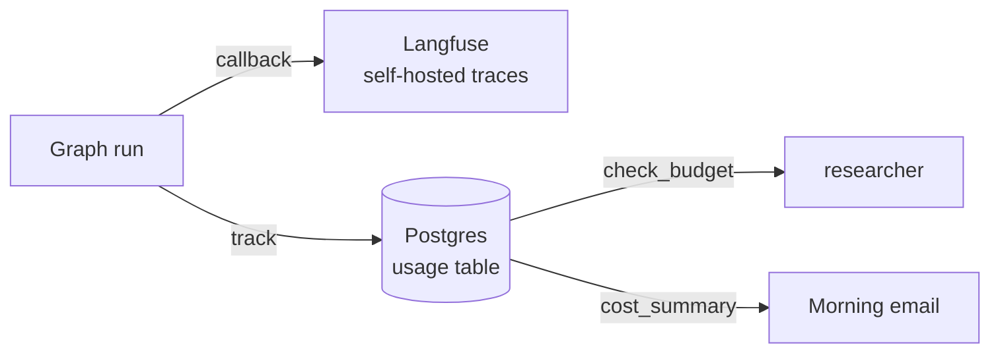

# Hephaestus

> Self-hosted multi-agent platform built with LangGraph. Create, schedule and monitor AI agents with cost control, evals and human-in-the-loop safety.

In Greek myth, Hephaestus forged golden automatons that worked on their own. This project forges AI agents.

**Status:** Milestones 2 of 7 done. A daily job-search agent that reads my SEEK job alerts, ranks every job against my profile, researches the best companies and emails me a report. Every run is traced in a self-hosted Langfuse, every model call is costed, and each agent has a monthly budget it cannot exceed.

---

## How it works



### The agent graph



| Node | Model | Job |
|---|---|---|
| `rank` | Qwen3 14B, local | Extracts every job from the alert and scores it 1 to 10 against my profile, as structured output |
| `dedupe` | None, plain code | Removes jobs already sent, using the SEEK job ID as key |
| `researcher` | Claude Haiku + Tavily | Looks up the companies behind the top 5 jobs. Stops itself if its monthly budget is used |
| `report` | Qwen3 14B, local | Writes the email, adds a cost summary and marks the jobs as sent |

Each node picks the model that fits the task. My profile and CV are only ever sent to the local model.

### Observability and cost control



| Part | Job |
|---|---|
| **Langfuse** | One trace per run. Shows every node, prompt, response, tool call, token count and latency |
| **`usage` table** | One row per model call with agent, model, tokens and cost. The source of truth for money |
| **Budget guard** | Before each call, `researcher` checks its spend this month. Over the limit, it skips research and says so in the report |
| **Cost summary** | Today's cost per agent and the month total, appended to every email |

Langfuse is for seeing and debugging. The `usage` table is what the platform acts on. Budgets keep working even if Langfuse is down.

---

## Tech stack

| Layer | Tool |
|---|---|
| Orchestration | LangGraph |
| Models | Claude via API, Qwen3 via Ollama on an RX 7900 XT |
| Search | Tavily |
| API | FastAPI, Uvicorn |
| Data | PostgreSQL |
| Observability | Langfuse, self-hosted |
| Automation | n8n, Gmail API |
| Scheduling | Windows Task Scheduler |
| Runtime | Docker Compose |

---

## Project structure

```
hephaestus/
├── app/
│   ├── __init__.py
│   ├── api.py          FastAPI endpoints
│   ├── budget.py       monthly budget guard per agent
│   ├── config.py       model selection, prices and budgets
│   ├── db.py           seen jobs, usage and cost queries in Postgres
│   ├── graph.py        the LangGraph agent
│   ├── models.py       Pydantic models
│   ├── tracing.py      Langfuse config for graph runs
│   ├── usage.py        tokens and cost per model call
│   └── tools/
│       └── search.py   Tavily search tool
├── n8n/
│   └── morning-jobs.json   exported n8n workflow
├── scripts/
│   └── trigger-morning.ps1 called by Task Scheduler
├── data/               private, git-ignored (profile, skills, test alerts)
├── evals/
├── Dockerfile
├── docker-compose.yml
├── requirements.txt
└── .env.example
```

---

## Getting started

### Requirements

- Docker Desktop
- Ollama with `qwen3:14b`
- Python 3.12
- API keys for Anthropic and Tavily
- A Google Cloud OAuth client for Gmail

### 1. Configure

```powershell
copy .env.example .env
```

Fill in the keys in `.env`. Add your own profile as `data/profile.md` and skills as `data/skills.yaml`.

### 2. Start Langfuse

Langfuse runs as its own Compose project next to this repo.

```powershell
git clone https://github.com/langfuse/langfuse.git
cd langfuse
```

Create a `.env` there with your own secrets for Postgres, ClickHouse, Redis and MinIO, set `TELEMETRY_ENABLED=false`, move its Postgres to port `5433`, and bind its ports to `127.0.0.1`. Then start it.

```powershell
docker compose up -d
```

Open `http://localhost:3000`, create a project and copy its API keys into `LANGFUSE_PUBLIC_KEY` and `LANGFUSE_SECRET_KEY` in this repo's `.env`.

### 3. Start Hephaestus

```powershell
ollama pull qwen3:14b
docker compose up -d --build
```

This starts PostgreSQL, n8n and the API. Check that the API is up.

```powershell
curl http://127.0.0.1:8000/health
```

### 4. Import the n8n workflow

Open `http://localhost:5678`, import `n8n/morning-jobs.json`, connect the Gmail and Header Auth credentials, and publish the workflow.

### 5. Schedule it

Create a Windows Task Scheduler task that runs `scripts/trigger-morning.ps1` daily at 06:00, with *Run task as soon as possible after a scheduled start is missed* enabled.

### Run the graph locally

```powershell
py -3.12 -m venv .venv
.venv\Scripts\Activate.ps1
pip install -r requirements.txt
python -m app.graph
```

---

## API

| Method | Path | Auth | Description |
|---|---|---|---|
| GET | `/health` | None | Health check |
| POST | `/run` | `X-API-Key` header | Runs the graph on `{"alert_text": "..."}` and returns `{"report": "...", "new_jobs": 0}` |

Interactive docs at `http://127.0.0.1:8000/docs`.

---

## Configuration

| Variable | Purpose |
|---|---|
| `ANTHROPIC_API_KEY`, `TAVILY_API_KEY` | Model and search providers |
| `ANTHROPIC_MODEL`, `OLLAMA_MODEL` | Which models the nodes use |
| `DATABASE_URL` | Postgres connection |
| `FASTAPI_KEY`, `N8N_WEBHOOK_KEY` | Separate keys for the API and the n8n webhook |
| `LANGFUSE_PUBLIC_KEY`, `LANGFUSE_SECRET_KEY`, `LANGFUSE_HOST` | Tracing |
| `RESEARCHER_BUDGET_USD` | Monthly budget for the researcher, default 2.0 |

---

## Security

- All ports bind to `127.0.0.1`, nothing is exposed to the network
- The API and the n8n webhook each have their own key, compared with `secrets.compare_digest`
- Secrets live in `.env` and n8n credentials, never in the repo
- Personal data is only processed by the local model
- Langfuse is self-hosted with telemetry and AI features off, so traces containing my profile never leave the machine
- `data/` is git-ignored

---

## Lessons learned

**Never let a model create IDs.** Copying an email with Ctrl+A drops the links, so the model invented job URLs, and duplicate detection broke. The fix was to keep the real links in the n8n cleanup step and use SEEK's job ID as the key.

**`localhost` is not always `127.0.0.1`.** On Windows, `localhost` tried IPv6 first and every Postgres connection hung until it timed out. A full run took 5 to 10 minutes. Using `127.0.0.1` with `connect_timeout=5` brought it down to about a minute.

**"Do not invent anything" is not a guarantee.** While testing the budget guard, the report model added a fifth job that did not exist, with a fake link, despite being told not to invent anything. Prompts reduce mistakes, they do not prevent them. The next step is to build the report layout in code and catch this with evals.

**Observability is not business logic.** Langfuse already counts tokens, so a separate `usage` table looks redundant. But traces are sent in the background with a delay, and the budget guard has to decide before each call. Keeping money in Postgres means budgets keep working even if Langfuse is down.

**Containers run the code they were built with.** Changes worked locally but not from n8n, because the API container still ran the old image. Every change in `app/` needs `docker compose up -d --build`.

**Thinking costs time.** Turning off Qwen3's reasoning mode for extraction cut the ranking step from about 45 seconds to about 10, with no visible loss in quality.

**Local models make different mistakes.** Qwen3 sometimes swaps job title and company, or replaces the title with my search term. These cases are being collected as test data for evals.

---

## Roadmap

| | Milestone | Status |
|---|---|---|
| M0 | Foundation, Docker Compose, Postgres | ✅ |
| M1 | One useful agent, daily job report | ✅ |
| M2 | Observability and cost control with Langfuse | ✅ |
| M3 | Team of agents with a supervisor | |
| M4 | Evals in GitHub Actions | |
| M5 | Agent registry, agents as data | |
| M6 | Dashboard | |
| M7 | MCP tools, human in the loop, guardrails | |

---

## Privacy

Hephaestus is a personal project. It reads my own job alert emails and sends reports to my own inbox. No data is shared with third parties beyond the model and search APIs the project uses.
