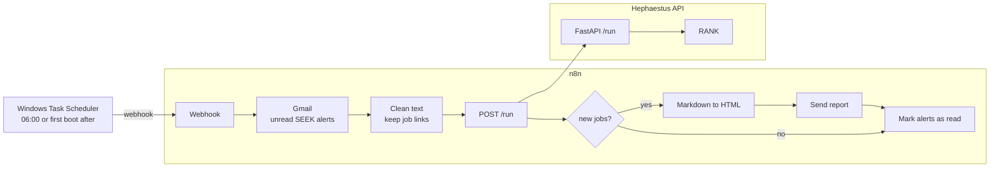
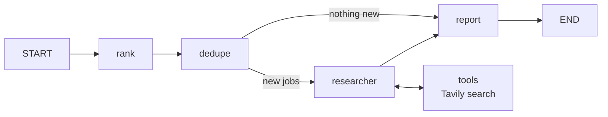

# Hephaestus

> Self-hosted multi-agent platform built with LangGraph. Create, schedule and monitor AI agents with cost control, evals and human-in-the-loop safety.

In Greek myth, Hephaestus forged golden automatons that worked on their own. This project forges AI agents.

**Status:** Milestone 1 of 7. A working daily job-search agent that reads my SEEK job alerts, ranks every job against my profile, researches the best companies and emails me a report.

---

## How it works



### The agent graph



| Node | Model | Job |
|---|---|---|
| `rank` | Qwen3 14B, local | Extracts every job from the alert and scores it 1 to 10 against my profile, as structured output |
| `dedupe` | None, plain code | Removes jobs already sent, using the SEEK job ID as key |
| `researcher` | Claude Haiku + Tavily | Looks up the companies behind the top 5 jobs |
| `report` | Qwen3 14B, local | Writes the email and marks the jobs as sent |

Each node picks the model that fits the task. My profile and CV are only ever sent to the local model.

---

## Tech stack

| Layer | Tool |
|---|---|
| Orchestration | LangGraph |
| Models | Claude via API, Qwen3 via Ollama on an RX 7900 XT |
| Search | Tavily |
| API | FastAPI, Uvicorn |
| Data | PostgreSQL |
| Automation | n8n, Gmail API |
| Scheduling | Windows Task Scheduler |
| Runtime | Docker Compose |

---

## Project structure

```
hephaestus/
├── app/
│   ├── __init__.py
│   ├── api.py          FastAPI endpoints
│   ├── config.py       model selection
│   ├── db.py           seen jobs in Postgres
│   ├── graph.py        the LangGraph agent
│   ├── models.py       Pydantic models
│   └── tools/
│       └── search.py   Tavily search tool
├── n8n/
│   └── morning-jobs.json   exported n8n workflow
├── scripts/
│   └── trigger-morning.ps1 called by Task Scheduler
├── data/               private, git-ignored (profile, test alerts)
├── evals/
├── Dockerfile
├── docker-compose.yml
├── requirements.txt
└── .env.example
```

---

## Getting started

### Requirements

- Docker Desktop
- Ollama with `qwen3:14b`
- Python 3.12
- API keys for Anthropic and Tavily
- A Google Cloud OAuth client for Gmail

### 1. Configure

```powershell
copy .env.example .env
```

Fill in the keys in `.env`. Add your own profile as `data/profile.md`.

### 2. Start everything

```powershell
ollama pull qwen3:14b
docker compose up -d --build
```

This starts PostgreSQL, n8n and the API. Check that the API is up.

```powershell
curl http://127.0.0.1:8000/health
```

### 3. Import the n8n workflow

Open `http://localhost:5678`, import `n8n/morning-jobs.json`, connect the Gmail and Header Auth credentials, and publish the workflow.

### 4. Schedule it

Create a Windows Task Scheduler task that runs `scripts/trigger-morning.ps1` daily at 06:00, with *Run task as soon as possible after a scheduled start is missed* enabled.

### Run the graph locally

```powershell
py -3.12 -m venv .venv
.venv\Scripts\Activate.ps1
pip install -r requirements.txt
python -m app.graph
```

---

## API

| Method | Path | Auth | Description |
|---|---|---|---|
| GET | `/health` | None | Health check |
| POST | `/run` | `X-API-Key` header | Runs the graph on `{"alert_text": "..."}` and returns `{"report": "...", "new_jobs": 0}` |

Interactive docs at `http://127.0.0.1:8000/docs`.

---

## Security

- All ports bind to `127.0.0.1`, nothing is exposed to the network
- The API and the n8n webhook each have their own key, compared with `secrets.compare_digest`
- Secrets live in `.env` and n8n credentials, never in the repo
- Personal data is only processed by the local model
- `data/` is git-ignored

---

## Lessons learned

**Never let a model create IDs.** Copying an email with Ctrl+A drops the links, so the model invented job URLs, and duplicate detection broke. The fix was to keep the real links in the n8n cleanup step and use SEEK's job ID as the key.

**`localhost` is not always `127.0.0.1`.** On Windows, `localhost` tried IPv6 first and every Postgres connection hung until it timed out. A full run took 5 to 10 minutes. Using `127.0.0.1` with `connect_timeout=5` brought it down to about a minute.

**Same prompt, different output.** The report model wrote bullet lists one run and a markdown table the next. A fixed template in the prompt solved it for now. The long-term fix is to build the layout in code and let the model write only the content.

**Local models make different mistakes.** Qwen3 sometimes swaps job title and company, or replaces the title with my search term. These cases are being collected as test data for evals.

---

## Roadmap

| | Milestone | Status |
|---|---|---|
| M0 | Foundation, Docker Compose, Postgres | ✅ |
| M1 | One useful agent, daily job report | 🔨 |
| M2 | Observability and cost control with Langfuse | |
| M3 | Team of agents with a supervisor | |
| M4 | Evals in GitHub Actions | |
| M5 | Agent registry, agents as data | |
| M6 | Dashboard | |
| M7 | MCP tools, human in the loop, guardrails | |

---

## Privacy

Hephaestus is a personal project. It reads my own job alert emails and sends reports to my own inbox. No data is shared with third parties beyond the model and search APIs the project uses.
